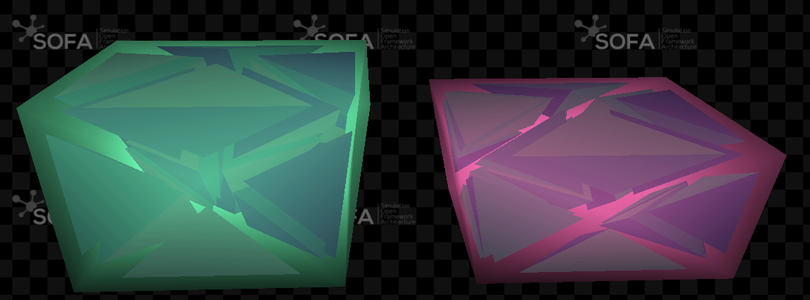

# PlasticConstraint

## Description
A SOFA plugin to simulate perfect plasticity from a lagrangian constraint, following similar principle to [this paper](https://hal.science/hal-05705273/document) in a geomechanics application.

In this current version, it only applies to simulations using TetrahedronFEMForceField in small deformations.
To apply plasticity, a child node has to be created containing a MechanicalObject gathering stress, a StressMapping to project tetraheda degrees of freedom to stress within elements and a BoxLagrangianConstraint to constrain the stress within a user-given limit.
To use the plugin, you have to take the TetrahedronFEMForceField.h and .inl files from the plugin to replace the ones from SOFA.

## Authors
- Alexandra Militan-Mocanu, Olivier Goury

## License
- GPL
